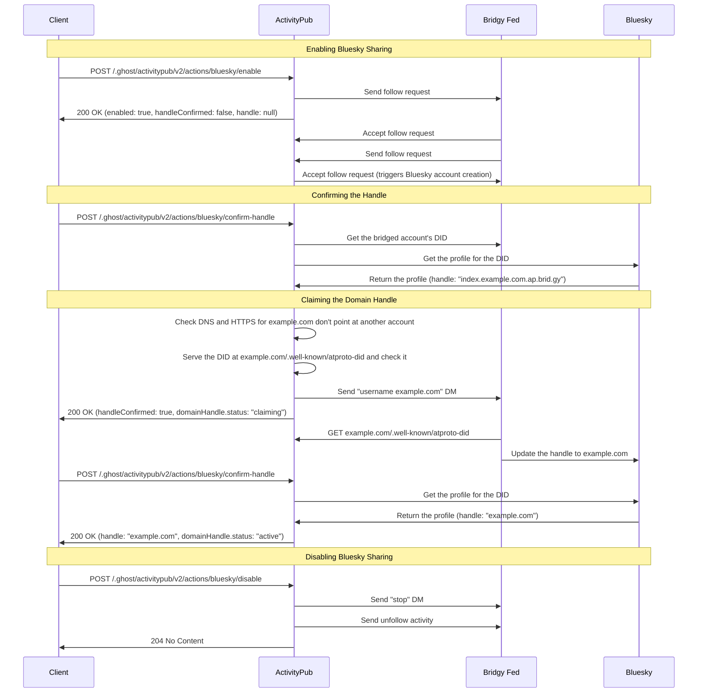

# Bluesky Sharing

## Overview

The Bluesky sharing feature enables Ghost sites to publish content to Bluesky
via [Bridgy Fed](https://fed.brid.gy/) - a bridge service that connects
ActivityPub accounts to the Bluesky network

Bridgy Fed gives the bridged account a handle like
`index.example.com.ap.brid.gy`. Where possible, the service switches it to the
site's domain, e.g. `example.com` - see [Domain handles](#domain-handles)

## Enabling Bluesky Sharing

To enable Bluesky sharing for a site, the client should make an empty POST
request to:

```
/.ghost/activitypub/v2/actions/bluesky/enable
```

This will return a `200 OK` response with the following body:

```json
{
    "enabled": true,
    "handleConfirmed": false,
    "handle": null,
    "domainHandle": null
}
```

At this point, Bluesky sharing is enabled for the site **BUT** the Bluesky
account may not exist yet - Bridgy Fed will follow the site's ActivityPub
account and create the Bluesky account. This is an asynchronous process, so the
client confirms the handle by making an empty POST request to:

```
/.ghost/activitypub/v2/actions/bluesky/confirm-handle
```

This will return a `200 OK` response with the following body:

```json
{
    "enabled": true,
    "handleConfirmed": false,
    "handle": null,
    "domainHandle": null
}
```

The "waiting" period should be short and is facilitated by the client - the
client should poll the endpoint periodically until the handle is confirmed, and
then while `domainHandle.status` is `claiming`. Once the handle is confirmed, a
response of `200 OK` will be returned with the following body:

```json
{
    "enabled": true,
    "handleConfirmed": true,
    "handle": "index.example.com.ap.brid.gy",
    "domainHandle": {
        "domain": "example.com",
        "status": "claiming",
        "reason": null
    }
}
```

The `/.ghost/activitypub/v1/account/me` endpoint will return information
regarding the status of the Bluesky sharing feature:

```json
{
    "blueskyEnabled": true,
    "blueskyHandleConfirmed": true,
    "blueskyHandle": "example.com",
    "blueskyDomainHandle": {
        "domain": "example.com",
        "status": "active",
        "reason": null
    }
}
```

## Domain handles

When the handle is confirmed, the service tries to switch the Bluesky handle to
the site's domain, so `example.com` is used instead of
`index.example.com.ap.brid.gy`. This happens automatically, both for new and
existing Bluesky accounts, the next time the handle is confirmed

### How it works

A domain is an atproto handle for whichever account it points at, via a DNS
`_atproto` TXT record or a `/.well-known/atproto-did` file
([spec](https://atproto.com/specs/handle)). The service:

1. Gets the bridged account's DID from Bridgy Fed
   (`https://fed.brid.gy/.well-known/atproto-did?protocol=ap&id=<actor id>`)
2. Picks the domains to try, best first: the account's fediverse handle domain
   (e.g. `example.com` for a site on `www.example.com`, or a custom webfinger
   domain), then the site's host
3. For each domain:
    - Skips it if a DNS `_atproto` record points at any other account, or if
      there's no DNS record and the domain's `/.well-known/atproto-did` points
      at another account (`taken`) - e.g. when the publisher already uses the
      domain for their own Bluesky account. DNS takes precedence over HTTPS in
      handle resolution, so serving our DID would not take the handle over,
      but it would never become ours either
    - Skips it if its DNS can't be checked (`dns_error`), rather than risk
      treating a temporary failure as "no record"
    - Starts serving the DID at `/.well-known/atproto-did`, and checks the
      domain actually serves it (`not_reachable` if not, usually because the
      proxy doesn't route the path to this service). A DNS record pointing at
      the bridged account is enough on its own
    - Sends the Bridgy Fed bot (`@bsky.brid.gy@bsky.brid.gy`) a
      `username <domain>` DM - Bridgy Fed checks the domain resolves to the
      account and updates the handle
4. Marks the domain handle `active` once the Bluesky profile uses it, or
   `unavailable` (`rejected`) if that hasn't happened after 10 minutes

Requests for `/.well-known/atproto-did` only follow redirects to HTTPS URLs on
public addresses, as the domain is set by whoever runs the site.

Each step only updates the domain handle if it's still in the state the step
started from, so overlapping confirmations don't claim the domain twice or undo
each other, and a claim in progress when the site moves to another domain is
dropped.

### Statuses

| `status`      | Meaning                                                                 |
| ------------- | ----------------------------------------------------------------------- |
| `claiming`    | The DID is served for the domain, waiting for Bridgy Fed to switch      |
| `active`      | The Bluesky account uses the domain as its handle                       |
| `unavailable` | The domain can't be used, see `reason`                                  |
| `opted_out`   | The publisher chose the default handle                                  |
| `released`    | The site moved to another domain (see [Domain changes](#domain-changes)) |

| `reason`        | Meaning                                                      |
| --------------- | ------------------------------------------------------------ |
| `taken`         | The domain already points at another atproto account         |
| `not_reachable` | The domain doesn't serve `/.well-known/atproto-did` from here |
| `dns_error`     | The domain's DNS couldn't be checked                          |
| `rejected`      | Bridgy Fed didn't switch to the domain in time                |

`domainHandle` is `null` until the domain handle has been tried

When a site on `www.` uses its root domain, and the root domain is a site of
its own too (e.g. one left behind by a www/non-www domain change), lookups for
the root domain fall back to the `www.` site only if it claimed the root domain.

### Proxy configuration

`/.well-known/atproto-did` must be routed to this service, like
`/.well-known/webfinger`. Without it, the domain is `not_reachable` and the
default handle keeps working as before. A site on `www.` can only use its root
domain if the root domain redirects to `www.` keeping the path, or is routed to
this service as well

### Retrying and opting out

To try the domain handle again (e.g. after fixing the proxy configuration, or
after opting out), make an empty POST request to:

```
/.ghost/activitypub/v2/actions/bluesky/domain-handle
```

To go back to the default handle, make a DELETE request to the same endpoint.
This sends Bridgy Fed a `username <default handle>` DM, stops serving the DID,
and the domain handle is not tried again until the POST request above is made

Both return the same body as `/confirm-handle`, or a `400 Bad Request` if the
integration is not enabled or the handle is not confirmed yet

### Domain changes

When a site moves to a new domain, it registers as a new site with a new
ActivityPub account, so Bluesky sharing starts out disabled for it. The previous
site's account stops serving its DID (`released`), so the old domain stops
resolving to the old Bluesky account. If the publication moves back, the domain
handle is claimed again

If the old account is moved to the new one (see `/v1/migration`), Bridgy Fed
moves the bridged Bluesky account - its DID and followers - to the new actor.
Enabling Bluesky sharing on the new site then switches its handle to the new
domain

## Disabling Bluesky Sharing

To disable Bluesky sharing for a site, the client should make an empty POST
request to:

```
/.ghost/activitypub/v2/actions/bluesky/disable
```

This will return a `204 No Content` response with an empty body

## Notes

- Handle confirmation looks the bridged account up by its DID
  (`https://public.api.bsky.app/xrpc/app.bsky.actor.getProfile?actor=<did>`),
  so it keeps working after the handle changes
- All endpoints are idempotent and safe to retry
- Calling `/enable` when already enabled returns the current status
- Calling `/disable` when already disabled succeeds with no changes
- If `/confirm-handle` is called before `/enable`, it returns a
  `400 Bad Request` with the message "Bluesky integration not enabled"
- The process can be visualised as follows:

